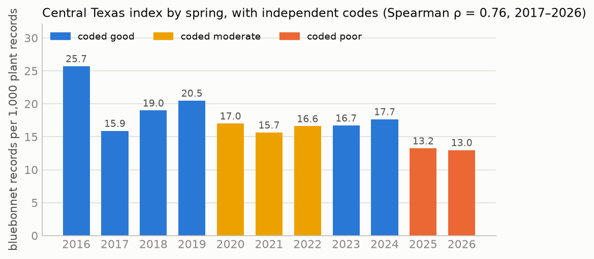
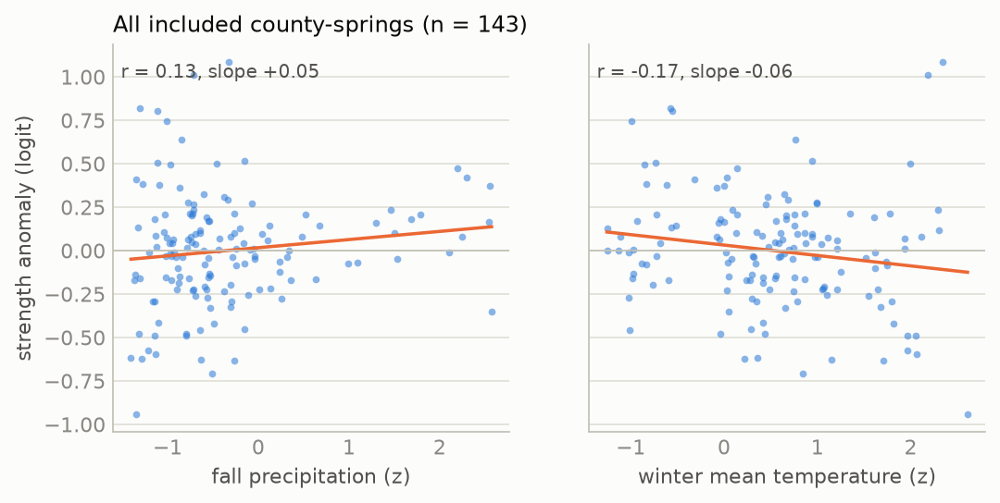
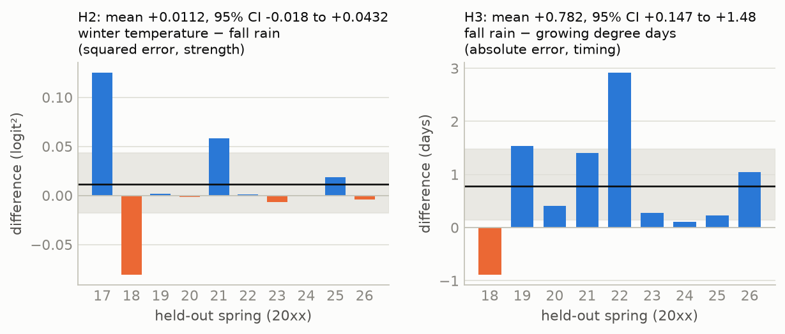
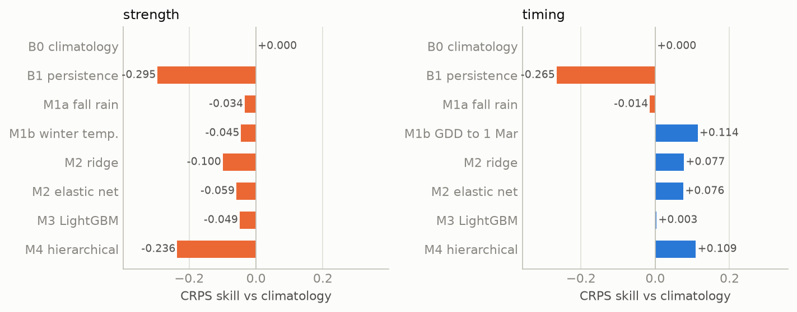
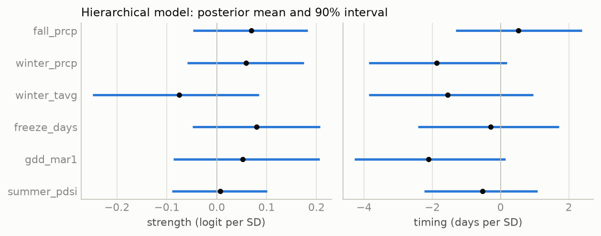
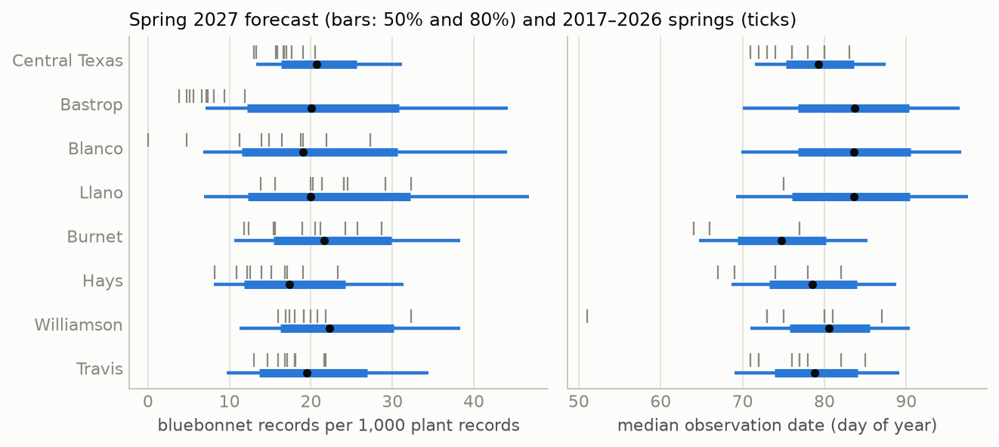

# Fall Rain, Winter Warmth, and the Texas Bluebonnet: A Pre-Registered Test and a Forecast for Spring 2027

| created | modified | status | confidence | importance |
|---|---|---|---|---|
| 2026-09-25 | 2026-09-25 | in progress | possible[^conf] | 3 |

> **Abstract.** Each spring, published wildflower forecasts for Central Texas attribute a strong Texas bluebonnet (*Lupinus texensis*) bloom to fall rain and treat winter temperature as a matter of timing. No peer-reviewed field study was found that measures either claim for this species. I test both claims with seven hypotheses committed to the project's git repository before any model was fit. Bloom strength is measured per county and spring as the share of all verifiable iNaturalist plant observations, 1 February–30 April, that are bluebonnets. Timing is measured as the effort-weighted median observation date. The data are 23,527 bluebonnet records in 15 Texas counties over ten springs (2017–2026), joined to NOAA county weather. The effort-normalized index agrees with independent published descriptions of each spring (Spearman ρ = 0.76, n = 10; the two lowest springs, 2025 and 2026, are the two described as poor). For strength, fall precipitation and winter mean temperature are **not distinguishable** under leave-one-year-out cross-validation: the paired difference in mean squared error is +0.011 in favor of fall rain (95% CI −0.018 to +0.043), and neither predictor, nor any of eight models including a hierarchical Bayesian model and a tuned gradient-boosted tree, predicts county bloom strength better than each county's own average (best CRPS skill −0.034). For timing, the order predicted by the published claims holds: growing degree days to 1 March predict the median date better than fall rain, by 0.78 days of mean absolute error (95% CI 0.15–1.48; 8 of 9 springs), and improve on climatology by 11% in CRPS. Two unregistered observations qualify the null result for strength: over the pooled seven-county Austin region, fall rain correlates with the index across springs (r = 0.63), and a downward trend of 0.05 logit per spring predicts county strength better than any weather variable. The pre-registered model's forecast for spring 2027, issued 25 September 2026 with every fall and winter month drawn from 26 El Niño analog seasons, places the Central Texas median date at 20 March (80% interval 13–28 March) and the strength index at 20.7 records per 1,000 plant records (13.3–31.2). The forecast is committed with its SHA-256, will be revised in December and March as fall and winter are observed, and will be graded in May 2027.

## Summary without the terminology

Texas bluebonnets sprout in autumn, grow slowly through the winter as a flat rosette of leaves, and flower in March and April. Every year, wildflower experts in Austin say that a good bloom depends on rain in the fall, and that a warm winter makes flowers come earlier. This report asks whether ten years of public data support those two statements, and then uses the data to make a forecast for spring 2027 that will be checked against what happens.

There is no official count of bluebonnets, so the report uses photographs uploaded to iNaturalist, a website where the public records plants and animals. Because many more people use iNaturalist each year, the number of bluebonnet photographs is divided by the number of photographs of any plant taken in the same county on the same days. The result is a measure of how much of people's attention to plants went to bluebonnets that spring.

1. **The measure agrees with what people reported.** Before looking at any weather, a separate reader classified each spring from 2016 to 2026 as good, moderate, or poor using only newspaper and Wildflower Center descriptions. The iNaturalist measure ranks the springs in a similar order, and its two lowest springs, 2025 and 2026, are the two that reporters described as poor.
2. **Fall rain did not predict how many bluebonnets a county would have.** County by county, a model using fall rain predicted the bloom no better than a model using winter temperature, and neither did better than simply predicting each county's usual level. Eight different prediction methods, from a straight line to a machine-learning model tuned over 24 settings, gave the same answer.
3. **For the Austin area as a whole, fall rain and the bloom did move together.** Summed over the seven Austin-area counties, springs after wet falls had stronger blooms (a correlation of 0.63 over ten years). This comparison was not planned in advance, and ten years are too few to separate it from chance.
4. **Winter warmth did predict when the bloom came.** Warmer winters were followed by earlier flowering: a measure of accumulated warmth to 1 March predicted the date better than fall rain did in 8 of 9 years, and improved on predicting each county's usual date by about 11%.
5. **The measure has been falling.** Bluebonnets made up a smaller share of plant photographs in 2025 and 2026 than in any earlier spring, and the share has declined on average since 2018. Whether this reflects fewer bluebonnets or a change in what iNaturalist users photograph cannot be decided from these data, and a simple downward trend predicts each county better than any weather variable.
6. **The forecast for 2027.** The model expects the Austin-area bloom to peak around 20 March 2027 (most likely between 13 and 28 March), with a strength close to the average of the last ten years and a wide range of uncertainty. The fall and winter weather are not yet known; a strong El Niño is expected, and the forecast was made by assuming weather like that of 26 past El Niño winters. The forecast will be updated in December and March and scored in May.

The practical conclusion is that the date of the bloom can be forecast from winter weather a few weeks ahead, while the size of the bloom in a particular county could not be forecast from weather with these data.

## 1. Background

### 1.1 The plant and the claim

*Lupinus texensis* is a winter annual of the Texas Blackland Prairie, Edwards Plateau, and surrounding regions. Seeds germinate in autumn, the plant overwinters as a rosette, and it flowers from March to early May ([Lady Bird Johnson Wildflower Center plant database](https://www.wildflower.org/plants/result.php?id_plant=lute)). The seed coat is impermeable to water, and only part of a seed lot germinates in any one autumn: untreated commercial seed lots emerged at 16–71%, and acid scarification raised this to 85–95% by opening pores in the coat ([Davis et al 1991](#references)). Seed that has not been scarified keeps its viability for at least a year in storage ([Mackay 2005](#references)). Much of what is seen along Texas roads was sown: seeding by the Department of Transportation and the public has genetically homogenized wild populations ([Turner et al 2018](#references)).

The claim under test comes from the statements that the Lady Bird Johnson Wildflower Center, Texas A&M AgriLife Extension, and Texas Parks and Wildlife staff make to the press each February and March. The 2025 forecast attributed a thin bloom to the preceding fall: "Last fall's drought influenced the number of little wildflower plants we have growing out there" ([Wildflower Center 2025](https://www.wildflower.org/pressroom/2025-wildflower-forecast)). In 2026, Center staff attributed a "moderate" season to a dry fall and said a warm winter had sped growth and shortened the bloom ([Fox 7 Austin, 18 March 2026](https://www.fox7austin.com/news/texas-experts-predict-moderate-bluebonnet-season-due-dry-fall-warm-winter)). The two statements together are a hypothesis with a structure: fall water controls how many plants establish; winter warmth controls when they flower. I found no peer-reviewed field study that measures either statement for *L. texensis*, and no study showing that the species requires winter chilling to flower.

### 1.2 Evidence from other winter annuals

The closest evidence comes from desert winter annuals. [Went 1949](#references) found in the Mojave Desert that about 10 mm of rain produced little germination and about 25 mm produced heavy germination, and that temperature at the time of the rain decided which species germinated. [Beatley 1974](#references) found that the Mojave winter-annual community germinated only after a fall rain event of sufficient size within a seasonal window. In the Sonoran Desert, the germinating rains have moved later, from October toward December, which changed which species establish ([Kimball et al 2010](#references)). If *L. texensis* behaves similarly, the amount and timing of fall rain should predict the number of rosettes, and the published claim would be correct. Central Texas receives more rain than the Mojave, however, and the seed-coat dormancy described above spreads germination over several rain events and years, both of which would weaken a one-season relationship.

For timing, the standard predictor of spring flowering is accumulated warmth, expressed as growing degree days ([McMaster & Wilhelm 1997](#references)). [Park & Mazer 2018](#references) screened seasonal climate variables with penalized regression and found that the variables best predicting flowering onset are not always the conventional ones, which is the reason the ladder of models in §4 includes a penalized regression over all eight predictors.

### 1.3 Measuring a bloom from citizen-science photographs

iNaturalist records are presence-only and opportunistic: nobody records the absence of a flower, and effort varies with weekends, weather, events, and the growth of the platform ([Di Cecco et al 2021](#references)). Two corrections are standard. First, dividing records of the target species by records of a *target group*, here all plants, from the same place and time uses the observers' other records as the measure of their effort ([Phillips et al 2009](#references)). Second, phenological dates estimated from such records are sensitive to uneven effort and should be read as properties of the observations rather than as the true first or peak flowering date ([Pearse et al 2017](#references); [Belitz et al 2020](#references); [Iler et al 2021](#references)). Showy species are over-recorded relative to abundance ([Callaghan et al 2021](#references)); bluebonnets are showy, so the index measured here is a relative quantity, compared within a county across springs.

### 1.4 Why the forecast is registered

A model fit to ten springs can be made to explain those ten springs with enough flexibility. The test of whether it has learned something is a prediction made before the outcome exists, scored by rules fixed before the outcome exists ([Nosek et al 2018](#references)). The hypotheses, targets, predictors, inclusion rules, model, forecast protocol, and grading rules were committed to the repository on 25 September 2026 (commit `d005cc9`, [`preregistration.md`](../preregistration.md)) before any county-level index was computed or any weather was joined to bloom data.[^seen] Four clarifications and one addition were logged in that file before the corresponding results existed; none changed a hypothesis or a decision rule.

## 2. Hypotheses

All seven were committed before any model was fit. The decision rule for each is part of the hypothesis; "LOYO" is leave-one-year-out cross-validation (§4.1), and every interval on a difference is a year-level paired bootstrap over the held-out springs (10,000 resamples).

- **H1 (target validity).** The effort-normalized strength index for the pooled Central Texas region ranks the springs as independent published descriptions do: Spearman ρ > 0.5 against the codes (poor 0, moderate 1, good 2), and both of the two lowest-index springs coded poor or moderate.
- **H2 (the published claim, strength).** Fall (September–November) precipitation predicts county bloom strength better than winter (December–February) mean temperature does, compared as single-predictor models by LOYO mean squared error. *Supported* if the 95% interval of the per-spring difference excludes zero in favor of fall rain; *reversed* if it excludes zero in favor of temperature; otherwise *not distinguishable at n = 10 springs*.
- **H3 (the published claim, timing).** Growing degree days to 1 March predict the median observation date better than fall precipitation does, by the same test with absolute error in days.
- **H4 (model ladder).** LightGBM does not have lower strength RMSE than ridge regression, and the hierarchical model's RMSE is within 5% of the better of the two.
- **H5 (partial pooling).** In counties with a median of fewer than 50 records per spring, the hierarchical model has lower LOYO RMSE than a separate regression per county.
- **H6 (calibration).** Nominal 80% prediction intervals cover between 70% and 90% of held-out county-springs.
- **H7 (lead time, prospective).** If fall rain carries the signal, the December forecast (fall observed) narrows the 2027 strength interval more than the March forecast (winter observed) does, and the reverse for timing. H7 is evaluated in May 2027.

## 3. Data

### 3.1 Records

Verifiable iNaturalist observations of *L. texensis* (taxon 49564) in Texas, observed 1 February–30 April and uploaded by 15 May of the same year, were retrieved from the [iNaturalist API](https://api.inaturalist.org/v1/docs/) on 25 September 2026. The upload cut-off makes every historical spring comparable to the 2027 spring, which will be retrieved on 15 May 2027; without it, earlier springs would include years of late uploads.[^lag]

| Spring | 2016 | 2017 | 2018 | 2019 | 2020 | 2021 | 2022 | 2023 | 2024 | 2025 | 2026 |
|---|---|---|---|---|---|---|---|---|---|---|---|
| Bluebonnet records, Texas | 208 | 499 | 1,145 | 1,708 | 1,841 | 1,797 | 1,857 | 3,178 | 4,591 | 3,141 | 3,562 |

Of the 23,527 records, 23,523 are research grade, and 4,821 (20.5%) fall on the days of the City Nature Challenge, a four-day bioblitz at the end of April in which the Austin, Dallas–Fort Worth, Houston, and San Antonio areas compete. Those days are removed from the numerator and the denominator. Every record carries a county place identifier, which assigns it to one of 191 Texas counties. The denominator is the daily count of verifiable Plantae records (taxon 47126) in the same county under the same filters.

### 3.2 Targets

For county *c* and spring *t*, with *y* bluebonnet records and *n* plant records:

- **Strength** is the empirical logit, log((*y* + 0.5)/(*n* − *y* + 0.5)). Point models predict it as an anomaly from the county's mean over the training springs. The hierarchical model uses *y* and *n* directly. For display it is expressed as bluebonnet records per 1,000 plant records.
- **Timing** is the effort-weighted median day of year: each day's bluebonnet count is divided by that day's plant count, the ratios are smoothed with a 7-day moving sum, and the median of the resulting distribution is the target. It is defined only for county-springs with at least 50 records.

The median is used rather than the date of the maximum because weekly county counts are too irregular to locate a maximum; I call it the median observation date, not the peak bloom date.

### 3.3 Counties

The pre-registered inclusion rule, at least 20 records in at least 6 of the 10 training springs, admits 15 counties: Travis, Williamson, Hays, and Burnet in the Austin area; Bexar and Comal to the south; Dallas, Tarrant, Denton, Collin, and Ellis in the Dallas–Fort Worth area; Harris; Bell and McLennan; and Gillespie. They supply 150 county-springs, 13,606 bluebonnet records, and 943,006 plant records. 143 county-springs have at least 5 records (the strength target of the point models) and 82 in 14 counties have at least 50 (the timing target). Three of the seven forecast counties fail the rule: Bastrop (4 qualifying springs), Llano (4), and Blanco (3). As registered, they are forecast by the hierarchical model with a new county effect and are flagged.

### 3.4 Weather

County monthly precipitation, mean temperature, and Palmer Drought Severity Index come from [NOAA nClimDiv](https://www.ncei.noaa.gov/access/monitoring/climate-at-a-glance/) (release of 4 September 2026, complete through August 2026). Freeze days (minimum ≤ −2 °C, December–February) and growing degree days (base 5 °C, 1 January–28/29 February) come from [GHCN-Daily](https://www.ncei.noaa.gov/products/land-based-station/global-historical-climatology-network-daily): for each county and season, the nearest station to the county's interior point with at least 90% of days present. 72 stations were used, at a median distance of 8.1 km. Every predictor is a z-score against the county's 1991–2020 springs.

### 3.5 Target validity (H1)

Before any weather was joined, an independent coder classified each spring from published statements only, under a rule committed before coding ([`bloom-year-codes.md`](../bloom-year-codes.md)); the coder did not access iNaturalist or weather data. Six springs were coded good, three moderate, and two poor.



*Figure 1. Bluebonnet records per 1,000 plant records in the seven forecast counties combined, 1 February–30 April, by spring; bar colour is the independent code. Data: `figures/data.json`.*

Spearman ρ between the pooled index and the codes is 0.76 for 2017–2026 (0.77 including 2016), and the two lowest springs, 2026 (13.0 per 1,000) and 2025 (13.2), are the two coded poor. **H1 is supported.** The index does not separate good from moderate springs well: 2017, coded good from four statements describing an early and abundant bloom, has the third-lowest value (15.9). The iNaturalist "Flowering" annotation, used alone, does not track the codes (ρ = −0.29), because the share of records carrying it rose from 6 of 73 in 2017 to 546 of 1,175 in 2024 in the pooled region; this confirms the registered decision to count every record in the window as flowering.

## 4. Method

### 4.1 Leave-one-year-out, anomalies, and climatology

Weather and observer behavior are shared by all counties in a spring, so a held-out Travis 2019 is not independent of a training Williamson 2019. Every model is therefore scored by holding out all counties of one spring, fitting on the other nine, and predicting the held-out spring, for each of the ten springs. The effective number of independent test units for a between-spring question is ten. Each hypothesis test resamples springs.

Counties differ in their baseline for reasons unrelated to weather (roadside seeding, habitat, observers). Point models are fit to the anomaly from each county's training mean. The model that predicts an anomaly of zero is **climatology** (B0), the forecast that each county will have its usual spring, and every model is scored against it as a skill, 1 − score(model)/score(climatology).

### 4.2 The ladder

| Rung | Model |
|---|---|
| B0 | Climatology: the county's mean over the training springs |
| B1 | Persistence: the county's value in the previous spring (tests carry-over through the seed bank) |
| M1a / M1b | OLS on fall precipitation / on winter mean temperature (strength); on fall precipitation / on growing degree days (timing) |
| M2 | Ridge regression ([Hoerl & Kennard 1970](#references)) and elastic net ([Zou & Hastie 2005](#references)) on all eight predictors, penalty chosen by inner leave-one-year-out |
| M3 | LightGBM ([Ke et al 2017](#references)) on all eight predictors, hyper-parameters from a 24-cell W&B sweep scored by LOYO |
| M4 | Hierarchical Bayesian model (§4.3) |
| — | Per-county OLS on fall precipitation (the no-pooling comparison for H5) |

The eight predictors are fall (September–November), September–October, and October–December precipitation; winter (December–February) precipitation and mean temperature; freeze days; growing degree days to 1 March; and June–August PDSI of the preceding summer.

### 4.3 The hierarchical model

For strength, with county *c* and spring *t*:

```
y[c,t] ~ BetaBinomial(n[c,t], μ·φ, (1 − μ)·φ)
logit μ = α + a[c] + b[t] + X[c,t]·β
a[c] ~ Normal(0, σ_c),  b[t] ~ Normal(0, σ_y),  β ~ Normal(0, 1),  φ ~ Gamma(2, 0.1)
```

The Beta-Binomial likelihood weights each county-spring by its counts, so a county-spring with 15 records influences the fit less than one with 3,000. The county effects are partially pooled: a county with few records is drawn toward the average of all counties ([Gelman & Hill 2007](#references)). The year effect absorbs anything shared by all counties in a spring, including observer behavior, so the weather coefficients β are identified both from differences between springs and from differences between counties within a spring. The six predictors of M4 are the non-overlapping ones (fall and winter precipitation, winter temperature, freeze days, growing degree days, summer PDSI).[^m4] For a spring the model has not seen, each posterior draw takes a new year effect shared by every county. The timing model has the same structure with a Student-t likelihood on the median date. Both were fit in PyMC ([Abril-Pla et al 2023](#references)) with the No-U-Turn Sampler ([Hoffman & Gelman 2014](#references)), four chains of 1,000 draws after 1,000 tuning steps, with the county and year effects in non-centred form.

### 4.4 Intervals and scores

Point models receive a predictive distribution from CV+, the cross-validation form of the jackknife+ ([Barber et al 2021](#references)): within each training fold, an inner leave-one-year-out gives residuals and refit predictions, and the test row's ensemble is every refit prediction plus every residual. The same ensemble gives the 80% interval and the continuous ranked probability score (CRPS; [Matheson & Winkler 1976](#references); [Gneiting & Raftery 2007](#references); [Hersbach 2000](#references)), so the point models and M4 are scored by the same rule. For a point forecast CRPS equals the absolute error; lower is better.

### 4.5 The forecast

The October issue uses nClimDiv through August 2026, so the preceding-summer PDSI is observed and every September–February month is unobserved. The Climate Prediction Center's El Niño advisory of September 2026 gives more than 90% probability of El Niño conditions through the winter ([CPC ENSO discussion](https://www.cpc.ncep.noaa.gov/products/analysis_monitoring/enso_advisory/ensodisc.shtml)), and El Niño winters are wetter than average in Texas ([Ropelewski & Halpert 1986](#references)). Unobserved months are therefore drawn from the 26 springs since 1951 that followed an October–December Oceanic Niño Index of +0.5 °C or more. Each posterior draw uses one analog year for every county jointly, which keeps the spatial pattern and the correlation between months of that year. 4,000 draws give the predictive distribution per county; the pooled Central Texas strength is computed from the sum of the simulated county counts.

## 5. Results

### 5.1 Target validity (H1)

Supported: ρ = 0.76, and the two lowest springs are coded poor (§3.5, Figure 1).

### 5.2 Fall rain against winter temperature for strength (H2)



*Figure 2. Strength anomaly (empirical logit minus the county mean) of every included county-spring against the fall precipitation and winter mean temperature z-scores, with least-squares lines. Data: `figures/data.json`.*

Across the 143 county-springs the anomaly correlates weakly with fall precipitation (r = 0.13, slope +0.05 logit per standard deviation) and with winter temperature (r = −0.17, slope −0.06). After removing each spring's mean, the within-spring correlation with fall precipitation is 0.09.

| Model (strength, LOYO) | MSE | RMSE | CRPS | CRPS skill |
|---|---|---|---|---|
| B0 climatology | 0.144 | 0.362 | 0.200 | 0 |
| M1a fall precipitation | 0.149 | 0.368 | 0.207 | −0.034 |
| M1b winter mean temperature | 0.160 | 0.379 | 0.209 | −0.045 |

The per-spring difference in MSE, winter minus fall, averages +0.011 (95% CI −0.018 to +0.043); fall rain has the lower error in 5 of 10 springs. **H2: not distinguishable at n = 10 springs.** Most of the mean comes from two springs, 2017 (+0.125) and 2021 (+0.058), against one spring favoring temperature, 2018 (−0.081) (Figure 3, left). Neither single predictor improves on climatology: fall rain minus climatology is −0.005 (−0.021 to +0.005), and winter temperature −0.016 (−0.043 to +0.004). Adding 2016 as an eleventh spring gives +0.014 (−0.013 to +0.039), fall better in 7 of 11.

The hierarchical model gives the same answer from within-spring and between-spring variation together. The posterior mean of the fall-precipitation coefficient is +0.069 logit per standard deviation (90% interval −0.048 to +0.183; probability positive 0.84), and that of winter temperature −0.075 (−0.249 to +0.085; probability negative 0.77). The probability that the fall coefficient is larger in magnitude than the temperature coefficient is 0.46. A coefficient of 0.07 corresponds to about a 7% change in the share of plant records that are bluebonnets per standard deviation of fall rain, against a county-spring standard deviation of about 36% (the climatology RMSE of 0.36 on the logit scale).



*Figure 3. Left: per-spring difference in mean squared error of the strength anomaly, winter-temperature model minus fall-rain model (positive favors fall rain). Right: per-spring difference in mean absolute error of the median date, fall-rain model minus growing-degree-day model (positive favors growing degree days). Black line: mean; grey band: 95% bootstrap interval. 2017 has no county-spring with 50 records and is absent from the timing panel. Data: `figures/data.json`.*

### 5.3 Growing degree days against fall rain for timing (H3)

| Model (timing, LOYO) | MAE (days) | RMSE (days) | CRPS | CRPS skill |
|---|---|---|---|---|
| B0 climatology | 5.30 | 7.01 | 3.91 | 0 |
| M1a fall precipitation | 5.40 | 7.03 | 3.97 | −0.014 |
| M1b growing degree days to 1 March | 4.60 | 6.56 | 3.47 | +0.114 |

The per-spring difference in mean absolute error, fall minus growing degree days, averages +0.78 days (95% CI +0.15 to +1.48); growing degree days have the lower error in 8 of 9 springs. **H3 is supported.** Growing degree days also improve on climatology, by 0.66 days (+0.07 to +1.37), in 8 of 9 springs. In the hierarchical timing model every warmth or wetness variable has a negative coefficient: growing degree days −2.1 days per standard deviation (90% interval −4.3 to +0.1; probability negative 0.94), winter precipitation −1.9 (probability negative 0.93), and winter temperature −1.6 (0.86); fall precipitation is +0.5 (probability positive 0.68). A winter one standard deviation warmer than the county normal moves the median observation date about two days earlier.

### 5.4 The ladder (H4)



*Figure 4. CRPS skill relative to climatology on held-out springs, strength (left) and timing (right). Negative values are worse than predicting each county's usual value. Data: `figures/data.json`; runs in W&B group `ladder`.*

| Rung | Strength RMSE | Strength CRPS skill | 80% coverage | Timing RMSE (days) | Timing CRPS skill | 80% coverage |
|---|---|---|---|---|---|---|
| B0 climatology | 0.362 | 0 | 0.89 | 7.01 | 0 | 0.90 |
| B1 persistence | 0.473 | −0.295 | 0.90 | 8.48 | −0.265 | 0.91 |
| M1a fall precipitation | 0.368 | −0.034 | 0.89 | 7.03 | −0.014 | 0.90 |
| M1b winter temp. / GDD | 0.379 | −0.045 | 0.91 | 6.56 | +0.114 | 0.91 |
| M2 ridge | 0.400 | −0.100 | 0.90 | 6.65 | +0.077 | 0.90 |
| M2 elastic net | 0.365 | −0.059 | 0.90 | 6.74 | +0.076 | 0.90 |
| M3 LightGBM, default | 0.454 | −0.208 | 0.90 | 7.15 | +0.088 | 0.91 |
| M3 LightGBM, sweep best | 0.387 | −0.049 | 0.90 | 6.81 | +0.003 | 0.90 |
| M4 hierarchical | 0.443 | −0.236 | 0.92 | 6.61 | +0.109 | 0.88 |

For strength, no rung improves on climatology. Persistence is the worst rung for both targets (−0.30 and −0.27), which gives no support to a seed bank carrying one year's bloom into the next at the scale of a county. The LightGBM sweep ([W&B](https://wandb.ai/within-noise/bluebonnet-bloom/sweeps/46na5ws9)) chose the smallest configuration in its grid (learning rate 0.03, 100 trees, at least 30 rows per leaf; 3, 7, and 15 leaves gave identical results because 30 rows per leaf allows at most four leaves), the configuration closest to predicting no change; the least constrained cell had strength RMSE 0.524. Choosing the cell by the same leave-one-year-out that reports it favors LightGBM, and the tuned model still does not reach climatology.

For strength, the tuned LightGBM (RMSE 0.387) is lower than ridge (0.400), and M4 (0.443) is more than 5% above both. **H4 is not supported for strength.** For timing, LightGBM (6.81) is not lower than ridge (6.65), and M4 (6.61) is within 5% of the better; **H4 is supported for timing.** M4's poor strength score has two sources. Its six weather coefficients move predictions away from the county mean in springs such as 2022 (mean error −0.58 logit against climatology's −0.10). And its predictive distribution is wider than climatology's (mean 80% width 1.52 against 1.26 logit), because the Beta-Binomial overdispersion (φ = 337) implies a county-spring standard deviation in the bluebonnet share of about 39% before any year effect is added.

### 5.5 Partial pooling (H5)

Eight counties have a median of fewer than 50 records per spring (Bell, Burnet, Collin, Comal, Ellis, Gillespie, Hays, McLennan; 73 county-springs). On those, the hierarchical model's RMSE is 0.449 and per-county OLS on fall precipitation 0.418. **H5 is not supported.** The pooling of county baselines does not compensate for the error added by the weather coefficients, which were estimated to be close to zero but not zero.

### 5.6 Calibration (H6)

Coverage of nominal 80% intervals: strength 0.895 (ridge), 0.902 (LightGBM), 0.916 (M4); timing 0.902, 0.902, 0.878. Three of six values exceed 0.90, by at most 0.016. **H6 is not met as registered**, although with 143 and 82 held-out rows the sampling standard deviation of a coverage near 0.8 is about 0.03 and 0.04, so the excess is within sampling error. The direction is consistent across models: the intervals are slightly too wide. The M4 posterior predictive check on the training springs confirms this for strength (0.98 of observed counts within the 80% interval of replicated data) and not for timing (0.89).

### 5.7 Sampling diagnostics

The two full fits used for the forecast have maximum R-hat 1.007 (strength) and 1.004 (timing), minimum bulk effective sample size 1,023 and 1,066, and no divergent transitions, which meets the registered requirement ([Vehtari et al 2021](#references)). Over the 19 leave-one-year-out fits, the maximum R-hat was 1.010, and three fits had one divergent transition each (strength with 2019 or 2022 held out; timing with 2024 held out).



*Figure 5. Posterior mean and 90% interval of each weather coefficient in the hierarchical strength model (logit per standard deviation, left) and timing model (days per standard deviation, right), fit on all ten springs. Data: `figures/data.json`.*

### 5.8 Exploratory analyses (not registered)

The following were computed after the registered results and should be read as observations for the next test, not as findings.

- **The pooled Austin region.** Summing the seven forecast counties gives one series of ten springs. Across it, the index correlates with fall precipitation (r = 0.63) and winter precipitation (r = 0.55) and less with winter temperature (r = −0.39); the median date correlates with winter temperature (r = −0.87) and growing degree days (r = −0.84). Leave-one-year-out on this series gives strength RMSE 0.126 with fall rain, 0.152 with climatology, and 0.159 with winter temperature; the paired interval for climatology minus fall rain includes zero (+0.007; −0.008 to +0.024). Timing RMSE is 2.4 days with winter temperature against 4.1 with climatology. Summing counties reduces the counting noise that dominates single counties, and it is at this scale that the published statements are made.
- **A downward trend.** The county strength anomaly declines by 0.050 logit per spring over 2017–2026, about 5% per year in the bluebonnet share. A model with only a linear trend has LOYO MSE 0.121, lower than climatology (0.144) and every weather model; adding fall precipitation to the trend raises it to 0.128. The trend could be a decline in bluebonnets, a change in what iNaturalist users photograph as the user base grows, or a consequence of the two dry falls falling at the end of the period. These data cannot separate the three.
- **Other windows.** Single-predictor LOYO MSE: October–December precipitation 0.143, winter precipitation 0.144, September–October 0.145, summer PDSI 0.147, fall 0.149, freeze days 0.152, growing degree days 0.158, winter temperature 0.160; climatology 0.144. No window improves on climatology by more than 0.001.

## 6. Discussion

### 6.1 Verdicts

| | Prediction | Outcome |
|---|---|---|
| H1 | index agrees with independent descriptions | ρ = 0.76; the two lowest springs are the two coded poor; **supported** |
| H2 | fall rain predicts strength better than winter temperature | +0.011 MSE (−0.018 to +0.043); **not distinguishable**; neither beats climatology |
| H3 | warmth predicts timing better than fall rain | +0.78 days MAE (+0.15 to +1.48), 8 of 9 springs; **supported** |
| H4 | LightGBM ≤ ridge; hierarchical within 5% | strength: **not supported**; timing: **supported** |
| H5 | partial pooling helps thin counties | 0.449 vs 0.418; **not supported** |
| H6 | 80% intervals cover 70–90% | 0.878–0.916; **not met** (too wide by up to 0.016) |
| H7 | December narrows strength more than March | evaluated May 2027 |

### 6.2 What this says about the published claim

The timing half of the claim is supported at the county level: warmer winters move the bloom earlier by about two days per standard deviation, and a model of growing degree days to 1 March forecasts the median date better than the county average. The strength half is not supported at the county level with ten springs: a county's fall rain does not predict its bloom better than its own average. The pooled series suggests the claim may describe the region better than it describes any one county, since the counting noise of a single county's records is large relative to the effect: the hierarchical model estimates the effect of one standard deviation of fall rain at about 7% of the bluebonnet share, against a county-spring standard deviation of about 36%. Detecting an effect of that size county by county would need several times more springs than exist. The observation that the two poorest springs, 2025 and 2026, followed the two driest falls in Travis County (70 and 98 mm against a normal of 263 mm) is what the published forecasts rely on; in these data it is also consistent with a steady decline in the index, and the two explanations make different predictions for 2027 after a wet El Niño fall.

### 6.3 Threats to validity

- **Ten springs.** Every between-spring comparison has ten units, and the paired intervals are correspondingly wide. H2's "not distinguishable" is a statement about this sample, not evidence that the effects are equal.
- **The index measures attention, not plants.** The target-group correction assumes that the share of observers' plant records given to bluebonnets in an average spring is constant over time. The downward trend in §5.8 may be a failure of that assumption, and if so it adds noise to every strength comparison.
- **Roadside seeding.** Much of what is photographed was sown ([Turner et al 2018](#references)). The county mean absorbs differences between counties but not changes in sowing between years.
- **Upload cut-off and quality grade.** Historical springs are filtered to uploads by 15 May, but their identifications have had years to accumulate. Only 4 of 23,527 records are not research grade, so this affects little.
- **The median date is not the peak.** It summarizes when bluebonnets were observed per unit of effort, and depends on how late observers continue to record them.
- **Out-of-sample winter.** A strong El Niño is expected; only 2015–16 in the iNaturalist period was comparable, and 30% of the winter-temperature scenario values lie outside the 2017–2026 range (§7.2).
- **Three forecast counties were not in training.** Bastrop, Llano, and Blanco are forecast from the average county, not from their own history, as registered; Bastrop's own level (a median of 6.9 per 1,000) is far below that average, and its strength forecast is expected to score poorly.

### 6.4 Cost

The data pulls took about an hour of API time, dominated by iNaturalist's latency of several seconds per page; everything after that runs on a laptop CPU. The whole ladder takes 100 seconds, the 24 sweep cells 47 seconds of run time in total, and the 21 hierarchical fits a few minutes.

## 7. The 2027 forecast

### 7.1 The registered numbers

Issue `forecast-2026-10`, computed 25 September 2026 from nClimDiv through August 2026. Strength is in bluebonnet records per 1,000 plant records; tercile probabilities are for below, near, and above the county's 2017–2026 terciles.

| County | Strength median | Strength 80% | P(below / near / above) | Median date | Date 80% | P(earlier / near / later) | Trend comparator |
|---|---|---|---|---|---|---|---|
| Travis | 19.5 | 9.7–34.5 | 0.39 / 0.05 / 0.56 | 20 Mar | 10–30 Mar | 0.28 / 0.14 / 0.58 | 13.1 (9.2–19.3) |
| Williamson | 22.3 | 11.3–38.3 | 0.32 / 0.09 / 0.59 | 22 Mar | 12–31 Mar | 0.17 / 0.30 / 0.53 | 15.0 (10.5–22.1) |
| Hays | 17.3 | 8.1–31.4 | 0.28 / 0.19 / 0.53 | 19 Mar | 10–30 Mar | 0.15 / 0.26 / 0.59 | 11.0 (7.7–16.2) |
| Burnet | 21.6 | 10.6–38.4 | 0.26 / 0.23 / 0.52 | 16 Mar | 6–26 Mar | 0.46 / 0.20 / 0.34 | 14.6 (10.2–21.5) |
| Llano (flagged) | 19.9 | 6.9–46.8 | 0.50 / 0.10 / 0.40 | 25 Mar | 10 Mar–8 Apr | 0.20 / 0.11 / 0.69 | 17.6 (12.4–26.0) |
| Blanco (flagged) | 19.1 | 6.8–44.1 | 0.33 / 0.17 / 0.51 | 25 Mar | 11 Mar–7 Apr | 0.18 / 0.11 / 0.71 | 10.2 (7.1–15.0) |
| Bastrop (flagged) | 20.1 | 7.1–44.2 | 0.06 / 0.05 / 0.89 | 25 Mar | 11 Mar–7 Apr | 0.18 / 0.11 / 0.71 | 5.2 (3.6–7.7) |
| **Central Texas** | **20.7** | **13.3–31.2** | 0.23 / 0.06 / 0.71 | **20 Mar** | **13–28 Mar** | 0.19 / 0.23 / 0.59 | 12.3 (8.7–18.3) |



*Figure 6. The spring 2027 forecast (dot: median; thick bar: 50% interval; thin bar: 80% interval) against the county's observed 2017–2026 values (grey ticks). Dates are days of year (79 = 20 March 2027). Counties without ticks in the right panel never reached 50 records in a spring. Data: `figures/data.json`; forecast: `forecasts/forecast-2026-10.csv` in the repository.*

The file `forecast-2026-10.csv` has SHA-256 `ffa92e6e90e161e9ca23b0980f72176eca06bfe81fc21be3af4436fdc5be3a7c`, and its 4,000 draws per county and target (`forecast-2026-10-samples.parquet`) `bd2746bcb99b5e605ba24b9a6cc98f683eafe79bec4c5829dbda5ec3687adeae`. Both are at git tag `forecast-2026-10`, in the W&B artifact `bluebonnet-forecast:forecast-2026-10`, and in the Hugging Face dataset.

### 7.2 How to read it

The strength forecast is close to each county's average with wide intervals, which is what a model with near-zero weather coefficients produces. Its centre lies about 0.1 logit above each included county's ten-spring mean of the observed index (Travis: −3.92 against −4.04). The El Niño scenarios contribute 0.01–0.07 logit of this, through the small positive coefficients on fall and winter precipitation; the remainder comes from how the model's baseline is defined (the mean of a skewed Beta distribution, fit with count weighting), not from a weather signal. Each county's ten observed values are clustered tightly relative to the forecast's spread, so the middle tercile holds little of the forecast's mass, and the offset places more of the remainder in the upper tercile than the lower. The ladder (§5.4) gives M4's strength forecast a CRPS skill of −0.24 against climatology on held-out springs, so the registered strength forecast is expected to score worse than climatology in May; it is registered because the pre-registration fixed M4 as the forecast model before the ladder was run. The trend comparator, added before the forecast was issued (change-log item 5), centres every county lower, at the extrapolated 2027 point of the decline in §5.8. The comparison between the two in May is a test of the trend against a return to the ten-spring average.

The timing forecast has positive held-out skill and is the part expected to score well. Its centre, 16–22 March in the four included Austin-area counties, is close to the ten-spring average because the winter is not yet observed; the 80% interval spans about 20 days in each of those counties and 16 days for the pooled region.

The scenarios matter less than their spread. Of the scenario values for winter temperature, 30.2% lie outside the 2017–2026 range, because the El Niño analog winters of the 1950s–1980s were colder than any recent winter; growing degree days are outside the range in 11.0% and winter precipitation in 4.4%. Observed so far: the 2026 summer was dry in most forecast counties (June–August PDSI −3.1 in Travis, −3.7 in Hays) and moist in Burnet (+1.3) and Llano (+1.5), and Camp Mabry in Austin recorded 8.3 mm of rain from 1 to 22 September against a Travis County September normal of 88 mm. September rainfall is reported here as description only; it enters the forecast in December.

### 7.3 Grading, fixed now

On or after 15 May 2027, the 2027 values are computed by the code at tag `forecast-2026-10` from iNaturalist data under the same filters (observed 1 February–30 April 2027, uploaded by 15 May 2027). For each issue and county, and for strength and timing: CRPS of the committed samples; CRPS of climatology (the county's ten training values); skill = 1 − CRPS/CRPS(climatology); whether the observation lies inside the 80% interval; and the ranked probability score of the tercile probabilities ([Epstein 1969](#references)). An issue is called skilful if its mean strength skill over the seven counties is positive. The scoring code, `scripts/13_grade.py`, is committed with this forecast.

### 7.4 Forecast record

| Issue | Computed | Data through | Observed predictors | Central Texas strength (80%) | Central Texas date (80%) |
|---|---|---|---|---|---|
| `forecast-2026-10` | 2026-09-25 | Aug 2026 | summer PDSI | 20.7 (13.3–31.2) | 20 Mar (13–28 Mar) |
| `forecast-2026-12` | about 2026-12-05 | Nov 2026 | + fall precipitation | pending | pending |
| `forecast-2027-03` | about 2027-03-03 | Feb 2027 | + winter | pending | pending |

## 8. Reproduction

- **Code, pre-registration, year codes, and forecasts:** [github.com/kvenanzi/bluebonnet](https://github.com/kvenanzi/bluebonnet). Thirteen numbered scripts take the public APIs to the registered forecast and, in May, to the grade; primers cover the [modeling methods](../modeling-primer.md) and the [plant and the data](../phenology-primer.md).
- **Dataset:** [kvenanzi/texas-bluebonnet-seasons](https://huggingface.co/datasets/kvenanzi/texas-bluebonnet-seasons): the county-spring table (aggregate counts and weather z-scores, no individual observations), the pre-registration, and every forecast with its samples.
- **Model:** [kvenanzi/bluebonnet-bloom-forecast](https://huggingface.co/kvenanzi/bluebonnet-bloom-forecast): posterior draws of both hierarchical models (NetCDF), ridge coefficients, the LightGBM model, and leave-one-year-out scores.
- **Every run:** the W&B project [within-noise/bluebonnet-bloom](https://wandb.ai/within-noise/bluebonnet-bloom) holds the ladder, the sweep, the hierarchical fits, and the forecast artifact; the [W&B Report](https://wandb.ai/within-noise/bluebonnet-bloom/reports/Texas-bluebonnet-bloom:-fall-rain,-winter-warmth,-and-a-registered-forecast-for-2027--VmlldzoxODAwNjAyNg==) presents them with live panels.

<!-- qmd
::: {.column-page-right}
```{=html}
<iframe src="https://wandb.ai/within-noise/bluebonnet-bloom/reports/Texas-bluebonnet-bloom:-fall-rain,-winter-warmth,-and-a-registered-forecast-for-2027--VmlldzoxODAwNjAyNg=="
        title="W&B Report: Texas bluebonnet bloom, fall rain, winter warmth, and a registered forecast for 2027"
        loading="lazy" style="border:none;width:100%;height:900px"></iframe>
```
:::
-->

## Appendix A: Experiment log

All work was done on 25 September 2026, in the order below. Run identifiers are W&B run IDs in `within-noise/bluebonnet-bloom`.

- **Feasibility.** Statewide yearly counts from the iNaturalist histogram endpoint, per-county counts for eight Austin-area counties, NOAA endpoints, and the CPC ENSO advisory. What was seen is listed in the pre-registration.
- **Pre-registration** (commit `d005cc9`). Hypotheses, targets, predictors, inclusion rule, models, forecast protocol, grading. Revised before commit to count verifiable records uploaded by 15 May of the same spring, after noticing that historical and 2027 data would otherwise differ in upload lag.
- **Year codes** (commit `4ac9c59`). An independent coder, blind to iNaturalist and weather data, coded 2016–2026 from 40 published statements. Committed with four clarifications of the pre-registration (county assignment, M4 predictors and priors, the October data cut, the eight-day 2016 City Nature Challenge).
- **Data.** 23,527 bluebonnet records (122 pages at 7–15 s each), 191 counties, 15 included; 396 daily histograms for 18 counties × 11 springs. nClimDiv release 20260904; 72 GHCN-Daily stations. Two builds of the county-spring table gave identical content hashes (`83d22224…`). Dataset artifact `bluebonnet-seasons:v0` (run `tt9pukxx`).
- **Ladder** (group `ladder`). Strength: climatology `8ris1j30`, persistence `re6xxfct`, fall `24o247ss`, winter temperature `3icav9nj`, ridge `5pl270yg`, elastic net `ewo62frr`, LightGBM `s9l5ufe2`, per-county `mcdq2sl2`. Timing: `wyvluwli`, `nuza5vce`, `raa9n0hg`, `43su0s0x`, `29xo3er8`, `oq47sw14`, `ha42hts0`, `725jmbk2`.
- **Sweep** `46na5ws9` (24 cells, run locally; a one-cell smoke sweep `ciaznjx1` tested the plumbing first). Best cell run `brh7b0f2`; rescored on the ladder as `5ziyz097` (strength) and `1hhse8kc` (timing).
- **Hierarchical models** `t84u8rba` (strength) and `l7qk074s` (timing), with posterior artifacts `hierarchical-logit` and `hierarchical-median_doy`. A two-chain plumbing run first exposed a held-out spring with no timing rows (2017), which is now skipped.
- **Hypotheses.** `scripts/06_hypotheses.py`; results as in §6.1.
- **Exploratory analyses** (§5.8) and change-log item 5 (trend comparator), before the forecast.
- **Forecast** `forecast-2026-10` (commit `75754e2`, tag `forecast-2026-10`, W&B run `8ndoyvhn`).

## Appendix B: Decisions

| Decision | Reason |
|---|---|
| Target = bluebonnet records / all plant records | iNaturalist effort grew about 40-fold; the target-group ratio removes effort common to all plants |
| Verifiable records uploaded by 15 May of the same spring | The 2027 target will be computed on 15 May 2027; earlier springs must be seen as they would have been then |
| City Nature Challenge days removed | One event contributes 20.5% of all records and a spike up to twice the real peak |
| Every record in the window counts as flowering | The Flowering annotation covers 17–38% of records and its use grew over time (confirmed: ρ = −0.29 when used alone) |
| Median date, not peak date | Weekly county counts are too irregular for a maximum |
| County by iNaturalist place for numerator and denominator | Both counts over the same polygon |
| Inclusion rule fixed before counts per county were computed | A rule chosen after seeing outcomes could select counties that agree |
| Leave-one-year-out, bootstrap over springs | All counties share a spring's weather and observers; the spring is the independent unit |
| Anomaly from the county's training mean | Counties differ in seeding and observers; climatology is the reference |
| CV+ ensembles for point models | Gives every rung a predictive distribution, so CRPS compares them on one rule |
| Beta-Binomial likelihood in M4 | Weights county-springs by counts without a threshold |
| Non-centred county and year effects | Standard remedy for divergences with few observations per group |
| M4 fixed as the forecast model in advance | Selecting the forecast model after seeing the ladder would make the registration meaningless |
| El Niño analogs since 1951, whole seasons, one analog per draw for all counties | Keeps the correlation between months and between counties; 26 analogs |
| Trend comparator added before the forecast, not substituted for M4 | The trend was found after registration; it can be tested but not adopted |
| Forecast samples committed, not only quantiles | CRPS in May needs the full distribution |
| Grading code committed with the forecast | The rules must exist before the outcome |
| Aggregate counts only on Hugging Face | Individual observations carry their observers' licenses |
| Sweep run locally rather than in Colab | The repository is private, so Colab cannot clone it; the Colab notebook is ready for a replication once it is public |

## References

- Abril-Pla O, Andreani V, Carroll C, Dong L, Fonnesbeck CJ, Kochurov M, Kumar R, Lao J, Luhmann CC, Martin OA, Osthege M, Vieira R, Wiecki T, Zinkov R (2023). "PyMC: a modern, and comprehensive probabilistic programming framework in Python". *PeerJ Computer Science* 9:e1516. [doi:10.7717/peerj-cs.1516](https://doi.org/10.7717/peerj-cs.1516)
- Barber RF, Candès EJ, Ramdas A, Tibshirani RJ (2021). "Predictive inference with the jackknife+". *The Annals of Statistics* 49(1):486–507. [doi:10.1214/20-AOS1965](https://doi.org/10.1214/20-AOS1965)
- Beatley JC (1974). "Phenological events and their environmental triggers in Mojave Desert ecosystems". *Ecology* 55(4):856–863. [doi:10.2307/1934421](https://doi.org/10.2307/1934421)
- Belitz MW, Larsen EA, Ries L, Guralnick RP (2020). "The accuracy of phenology estimators for use with sparsely sampled presence-only observations". *Methods in Ecology and Evolution* 11(10):1273–1285. [doi:10.1111/2041-210X.13448](https://doi.org/10.1111/2041-210X.13448)
- Callaghan CT, Poore AGB, Hofmann M, Roberts CJ, Pereira HM (2021). "Large-bodied birds are over-represented in unstructured citizen science data". *Scientific Reports* 11:19073. [doi:10.1038/s41598-021-98584-7](https://doi.org/10.1038/s41598-021-98584-7)
- Davis TD, George SW, Upadhyaya A, Parsons J (1991). "Improvement of seedling emergence of *Lupinus texensis* Hook. following seed scarification treatments". *Journal of Environmental Horticulture* 9(1):17–21. [doi:10.24266/0738-2898-9.1.17](https://doi.org/10.24266/0738-2898-9.1.17)
- Di Cecco GJ, Barve V, Belitz MW, Stucky BJ, Guralnick RP, Hurlbert AH (2021). "Observing the observers: how participants contribute data to iNaturalist and implications for biodiversity science". *BioScience* 71(11):1179–1188. [doi:10.1093/biosci/biab093](https://doi.org/10.1093/biosci/biab093)
- Epstein ES (1969). "A scoring system for probability forecasts of ranked categories". *Journal of Applied Meteorology* 8(6):985–987. [doi:10.1175/1520-0450(1969)008<0985:ASSFPF>2.0.CO;2](https://doi.org/10.1175/1520-0450(1969)008%3C0985:ASSFPF%3E2.0.CO;2)
- Gelman A, Hill J (2007). *Data Analysis Using Regression and Multilevel/Hierarchical Models*. Cambridge University Press. [doi:10.1017/CBO9780511790942](https://doi.org/10.1017/CBO9780511790942)
- Gneiting T, Raftery AE (2007). "Strictly proper scoring rules, prediction, and estimation". *Journal of the American Statistical Association* 102(477):359–378. [doi:10.1198/016214506000001437](https://doi.org/10.1198/016214506000001437)
- Hersbach H (2000). "Decomposition of the continuous ranked probability score for ensemble prediction systems". *Weather and Forecasting* 15(5):559–570. [doi:10.1175/1520-0434(2000)015<0559:DOTCRP>2.0.CO;2](https://doi.org/10.1175/1520-0434(2000)015%3C0559:DOTCRP%3E2.0.CO;2)
- Hoerl AE, Kennard RW (1970). "Ridge regression: biased estimation for nonorthogonal problems". *Technometrics* 12(1):55–67. [doi:10.1080/00401706.1970.10488634](https://doi.org/10.1080/00401706.1970.10488634)
- Hoffman MD, Gelman A (2014). "The No-U-Turn Sampler: adaptively setting path lengths in Hamiltonian Monte Carlo". *Journal of Machine Learning Research* 15:1593–1623. [jmlr.org/papers/v15/hoffman14a.html](https://jmlr.org/papers/v15/hoffman14a.html)
- Iler AM, Humphrey PT, Ogilvie JE, CaraDonna PJ (2021). "Conceptual and practical issues limit the utility of statistical estimators of phenological events". *Ecosphere* 12(11):e03828. [doi:10.1002/ecs2.3828](https://doi.org/10.1002/ecs2.3828)
- Ke G, Meng Q, Finley T, Wang T, Chen W, Ma W, Ye Q, Liu T-Y (2017). "LightGBM: a highly efficient gradient boosting decision tree". *Advances in Neural Information Processing Systems 30*:3146–3154. [papers.nips.cc](https://papers.nips.cc/paper/6907-lightgbm-a-highly-efficient-gradient-boosting-decision-tree)
- Kesselman RF (2008). "Verbal Probability Expressions in National Intelligence Estimates: A Comprehensive Analysis of Trends from the Fifties through Post 9/11". Master's thesis, Mercyhurst College. [PDF](https://www.files.ethz.ch/isn/55739/kesselman_thesis_final.pdf)
- Kimball S, Angert AL, Huxman TE, Venable DL (2010). "Contemporary climate change in the Sonoran Desert favors cold-adapted species". *Global Change Biology* 16(5):1555–1565. [doi:10.1111/j.1365-2486.2009.02106.x](https://doi.org/10.1111/j.1365-2486.2009.02106.x)
- Mackay WA (2005). "Effect of scarification, seed storage temperature, and relative humidity on *Lupinus havardii* Wats. and *Lupinus texensis* Hook. seed germination". *HortScience* 40(3):782–785. [doi:10.21273/HORTSCI.40.3.782](https://doi.org/10.21273/HORTSCI.40.3.782)
- Matheson JE, Winkler RL (1976). "Scoring rules for continuous probability distributions". *Management Science* 22(10):1087–1096. [doi:10.1287/mnsc.22.10.1087](https://doi.org/10.1287/mnsc.22.10.1087)
- McMaster GS, Wilhelm WW (1997). "Growing degree-days: one equation, two interpretations". *Agricultural and Forest Meteorology* 87(4):291–300. [doi:10.1016/S0168-1923(97)00027-0](https://doi.org/10.1016/S0168-1923(97)00027-0)
- Nosek BA, Ebersole CR, DeHaven AC, Mellor DT (2018). "The preregistration revolution". *Proceedings of the National Academy of Sciences* 115(11):2600–2606. [doi:10.1073/pnas.1708274114](https://doi.org/10.1073/pnas.1708274114)
- Park IW, Mazer SJ (2018). "Overlooked climate parameters best predict flowering onset: assessing phenological models using the elastic net". *Global Change Biology* 24(12):5972–5984. [doi:10.1111/gcb.14447](https://doi.org/10.1111/gcb.14447)
- Pearse WD, Davis CC, Inouye DW, Primack RB, Davies TJ (2017). "A statistical estimator for determining the limits of contemporary and historic phenology". *Nature Ecology & Evolution* 1(12):1876–1882. [doi:10.1038/s41559-017-0350-0](https://doi.org/10.1038/s41559-017-0350-0)
- Phillips SJ, Dudík M, Elith J, Graham CH, Lehmann A, Leathwick J, Ferrier S (2009). "Sample selection bias and presence-only distribution models: implications for background and pseudo-absence data". *Ecological Applications* 19(1):181–197. [doi:10.1890/07-2153.1](https://doi.org/10.1890/07-2153.1)
- Ropelewski CF, Halpert MS (1986). "North American precipitation and temperature patterns associated with the El Niño/Southern Oscillation (ENSO)". *Monthly Weather Review* 114(12):2352–2362. [doi:10.1175/1520-0493(1986)114<2352:NAPATP>2.0.CO;2](https://doi.org/10.1175/1520-0493(1986)114%3C2352:NAPATP%3E2.0.CO;2)
- Turner KG, Huang DI, Cronk QCB, Rieseberg LH (2018). "Homogenization of populations in the wildflower, Texas bluebonnet (*Lupinus texensis*)". *Journal of Heredity* 109(2):152–161. [doi:10.1093/jhered/esx094](https://doi.org/10.1093/jhered/esx094)
- Vehtari A, Gelman A, Simpson D, Carpenter B, Bürkner P-C (2021). "Rank-normalization, folding, and localization: an improved R̂ for assessing convergence of MCMC". *Bayesian Analysis* 16(2):667–718. [doi:10.1214/20-BA1221](https://doi.org/10.1214/20-BA1221)
- Went FW (1949). "Ecology of desert plants. II. The effect of rain and temperature on germination and growth". *Ecology* 30(1):1–13. [doi:10.2307/1932273](https://doi.org/10.2307/1932273)
- Zou H, Hastie T (2005). "Regularization and variable selection via the elastic net". *Journal of the Royal Statistical Society: Series B* 67(2):301–320. [doi:10.1111/j.1467-9868.2005.00503.x](https://doi.org/10.1111/j.1467-9868.2005.00503.x)

## Footnotes

[^conf]: Status and confidence tags follow the gwern.net convention; the confidence word is from the [Kesselman 2008](#references) scale. "Possible" is the overall word because the three parts of the report differ. I consider it likely that winter warmth moves the median observation date earlier by one to three days per standard deviation (H3, the hierarchical coefficient, and the pooled series agree). I consider it likely that no single weather variable predicts a single county's bloom strength well enough to be useful with ten springs. Whether fall rain drives the regional bloom is possible and unresolved; the pooled correlation is suggestive and the trend is an equally simple alternative. I consider it unlikely that the registered strength forecast will beat climatology in May, and likely that the timing forecast will.

[^seen]: Before the pre-registration was written, the feasibility check had retrieved statewide yearly counts of bluebonnet and plant records and per-year counts for eight Austin-area counties, and had read the published statements that 2025 and 2026 were poor or moderate after a dry fall. No weather data and no county-level ratio had been examined. The list is in the pre-registration.

[^lag]: The API's `created_d2` parameter filters on upload date. Quality grade cannot be filtered as of a past date, so historical records are counted at their current grade; because both research-grade and needs-ID records are counted, and only 4 of 23,527 bluebonnet records are needs-ID, this affects the numerator by less than 0.1%.

[^m4]: September–October and October–December precipitation overlap the fall window and enter M2 and M3 only, as §7 of the pre-registration states. The pre-registration did not list M4's predictors or all of its priors; both were fixed in its change log before any model was fit.
